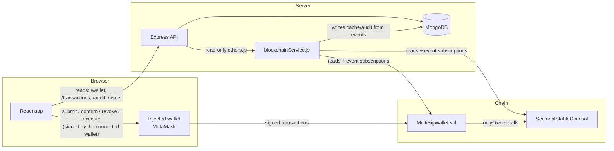
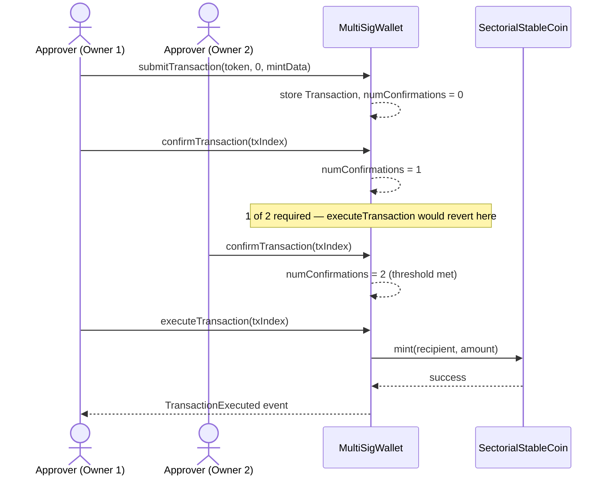
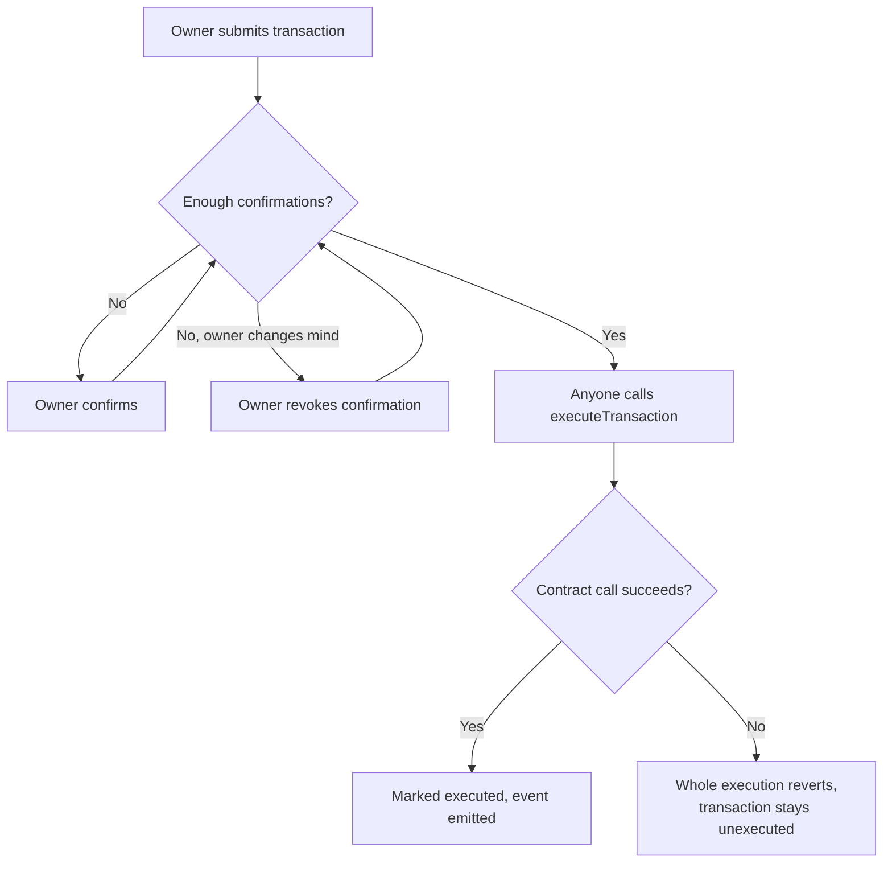
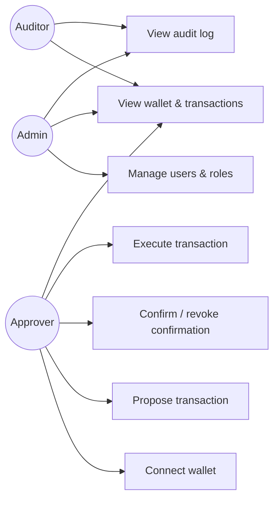
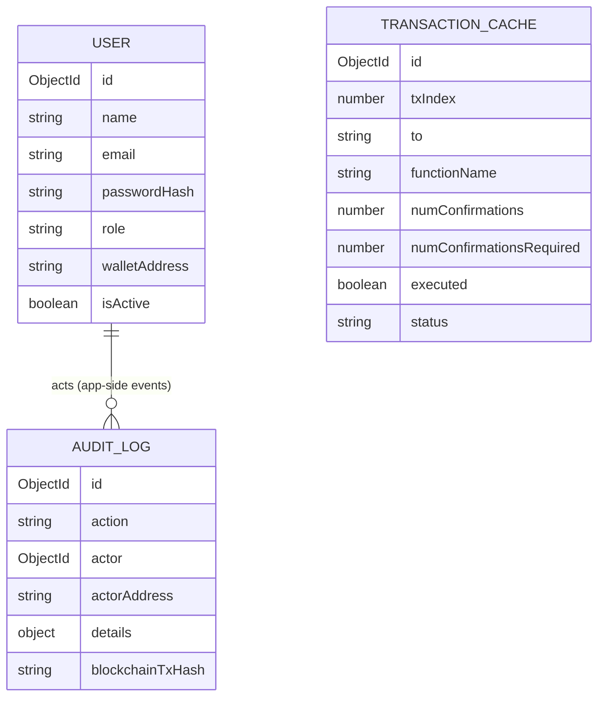

# Architecture

## Component responsibilities

| Layer | Owns | Never does |
|---|---|---|
| Smart contracts | Owner list, threshold, approval counts, execution, token balances/supply | Trust any off-chain claim of "approved" |
| Backend | Auth (JWT/bcrypt), role management, MongoDB metadata, event-driven cache sync, input validation | Sign a transaction on a user's behalf; mark a tx approved/executed without reading it from chain |
| Frontend | UI/UX, wallet connection, calling contract methods directly for state-changing actions, calling the backend for metadata/roles | Fabricate approval counts instead of reading contract state |
| MongoDB | Users, transaction cache, audit log | Be authoritative for balances or approval state |

The wallet-signed design is deliberate: an `APPROVER`'s confirmation is only
meaningful if it's a real signature from their own key. If the backend
signed on their behalf, "multiple independent approvers" would collapse
into "one backend with everyone's trust."

## System diagram



## Multi-signature approval sequence



## Activity diagram: proposing and resolving a transaction



## Use case diagram



## ER diagram (MongoDB — application metadata only)



Note there is no foreign key from `TRANSACTION_CACHE` to `USER` — the chain
identifies actors by address, not by application user ID. A cached
transaction's `submitter`/confirmer addresses may or may not correspond to
a registered user.

## Folder structure

```
sectorial-wallet/
├── blockchain/
│   ├── contracts/{MultiSigWallet,SectorialStableCoin}.sol
│   ├── scripts/deploy.js
│   └── test/*.test.js
├── backend/
│   └── src/{config,controllers,middleware,models,routes,services,utils}
├── frontend/
│   └── src/{components,context,hooks,pages,services,utils}
└── docs/
```

## Key implementation decisions

1. **Wallet-signed approvals**, not backend-custodied keys — see rationale above.
2. **Purpose enforcement was deliberately removed.** An earlier draft
   included a `ScholarshipController` restricting spending to categories
   like tuition/books. That layer was dropped; `SectorialStableCoin` is
   a general-purpose token whose only sector-specific feature is the
   `sector` label, not an enforced spending restriction.
3. **`MultiSigWallet` is generic call-forwarding**, not token-specific —
   it can propose a call to any address with any data, which is what lets
   it also govern itself (owner/threshold changes) and the token (mint,
   burn, pause, freeze) through the same mechanism.
4. **No `submitter` role** — only wallet owners can propose transactions.
   An earlier draft had a separate submitter role so a non-owner contract
   could propose on a beneficiary's behalf; removed along with the
   scholarship layer.
